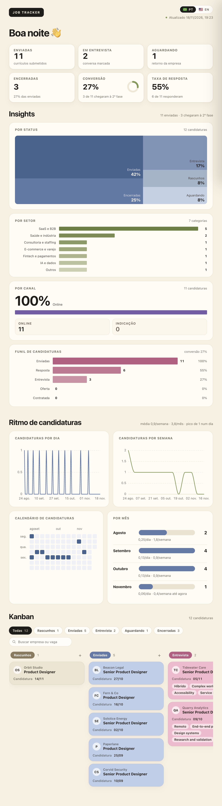

# AI Job Tracker Dashboard

A single-file dashboard for your job search: every application on one kanban board, with stats and insights to help you track your progress. Built on top of [AI Job Search](https://github.com/ai-job-search-dev/ai-job-search), offline, no account, no API key.

**[See the demo](https://laislarav.github.io/ai-job-tracker-dashboard/)** — built from the fictional data in `sample/`.



---

## First step: you need AI Job Search

This dashboard reads the files that [AI Job Search](https://github.com/ai-job-search-dev/ai-job-search) writes. If you do not have it yet, start there:

1. Set up the framework: `gh repo clone ai-job-search-dev/ai-job-search` → `/setup` → `/scrape` → `/apply`.
2. Come back here once your `job_search_tracker.csv` has a few rows.
3. If you want to see the workflow in action before setting anything up, [AI Job Search Agent walkthrough](https://www.youtube.com/watch?v=HoVxjMNFYv4) shows it end to end (recorded August 2026).

Already running the framework? Skip to [Quick start](#quick-start).

## What you get

- **Kanban board** of every application, grouped by status, with search and filters.
- **Application drawer**: posting summary, what changed in the CV, talking points, interview stages, dated history.
- **Insights**: status treemap, sector ranking, channel split, conversion funnel.
- **Pace**: applications per day and per week as line charts, a GitHub-style calendar of daily activity, and a by-month breakdown.
- **Bilingual UI** (PT-BR / EN), light theme, one self-contained HTML file of about 90 KB.

## Quick start

Copy `tools/dashboard/` into your AI Job Search repo, keeping the path:

```
your-repo/
├── tools/dashboard/build.py
├── tools/dashboard/template.html
├── job_search_tracker.csv
└── documents/applications/
```

Build and open:

```bash
python3 tools/dashboard/build.py
open reports/dashboard.html        # macOS
# xdg-open reports/dashboard.html  # Linux
```

Requirements: Python 3.9 or newer. Standard library only, nothing to install.

If an AI agent is doing the setup, point it at [AGENTS.md](AGENTS.md): it carries the decision tree for missing data and the rules for reporting back.

Rebuild after every application, every status change, and every new CV. The output is generated; never edit `reports/dashboard.html` by hand.

## What it reads

| Input | Used for |
|---|---|
| `job_search_tracker.csv` | one row per application: company, role, status, dates, fit, notes |
| `documents/applications/<company>_<role>/job_posting.md` | posting summary and requirements in the drawer |
| `documents/applications/<company>_<role>/cv_draft.tex` | positioning line and skills in the drawer |
| `documents/applications/<company>_<role>/outcome.md` | interview stages and dated history |
| `documents/applications/<company>_<role>/dashboard.json` | optional enrichment, below |

Tracker columns, in order:

```
date,company,sector,role,role_type,channel,status,contact_person,fit_rating,notes,cv_file,cover_letter_file,source,deadline
```

Statuses: `drafted`, `applied`, `interview`, `hold`, `offer`, `hired`, `rejected`, `no_response`, `offer_declined`, `withdrawn`.

Everything is optional except the tracker. Missing archives degrade gracefully: the card still shows, the drawer just has less to say.

## Optional enrichment

Drop a `dashboard.json` next to an application to override what the build infers:

```json
{
  "workMode": "remote",
  "skills": ["Design systems", "Research"],
  "requirements": ["Own the component library", "Partner with engineering"],
  "adaptations": ["Led with the platform rebuild"],
  "talkingPoints": ["Bring the accessibility audit"],
  "postingSummary": "One paragraph, if the posting was not archived.",
  "interviewDate": "2026-11-18",
  "deadline": "2026-12-01"
}
```

## Configuration

- `dashboard.config.json` at the repo root, optional: `{"ownerName": "Your Name"}` puts your name in the greeting.
- `--root` builds against another folder. That is how `docs/index.html` is built from `sample/`.
- `--out` writes the HTML somewhere else.

```bash
python3 tools/dashboard/build.py --root sample --out docs/index.html
```

## Privacy

The build reads your files and writes one HTML file. It never sends anything anywhere.

Keep these out of git when you run this for real:

```gitignore
/reports/
/job_search_tracker.csv
/documents/applications/**
/dashboard.config.json
```

The demo in `docs/` is generated from fictional companies and fictional applications. No personal data is committed here.

## Customising

Everything visual lives in `tools/dashboard/template.html`: the palette in `:root`, the copy in the `I18N` object, the charts in plain JavaScript. Edit, rebuild, done.

## Tests

```bash
python3 -m unittest tests.test_dashboard_build
```

The suite runs against your tracker when the repo has one, and against `sample/` otherwise.

## Credits

- Built on [AI Job Search](https://github.com/ai-job-search-dev/ai-job-search) by Mads Lorentzen. Independent project, not affiliated.
- The walkthrough that shows the workflow end to end: [The Next New Thing](https://www.youtube.com/watch?v=HoVxjMNFYv4).
- Dashboard design and code: [Laís Lara Vacco](https://github.com/laislarav).

## License

MIT. See [LICENSE](LICENSE).
